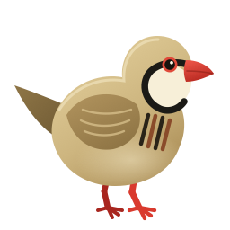

<div align="center">



# KEW v2

**Anonymous · Free · Open** video downloader

YouTube · TikTok · Instagram · X · Facebook · Vimeo · Reddit · SoundCloud · Twitch · and 1000+ more sites

*Kew* means **keklik** (the chukar partridge) in Kurdish — a free bird of the mountains.

**by [Cybergah Group](https://cybergah.com) · GPL-3.0**

`ku` `tr` `ar` `en` `fa`

---

[](https://github.com/cybergah8-lang/KEW/releases/latest)
[](LICENSE)
[](https://github.com/cybergah/KEW/actions/workflows/build.yml)
[](https://github.com/cybergah8-lang/KEW/releases/latest)

</div>

---

## 📥 Download

| Platform | File | Notes |
|----------|------|-------|
| 🤖 Android | [Kew-2.0.0-android-debug.apk](https://github.com/cybergah8-lang/KEW/releases/latest) | Enable "Install from unknown sources" |
| 🪟 Windows | [Kew-Setup-2.0.0.exe](https://github.com/cybergah8-lang/KEW/releases/latest) | Installer |
| 🍎 macOS | [Kew-2.0.0-mac-universal.dmg](https://github.com/cybergah8-lang/KEW/releases/latest) | Right-click → Open on first launch |

---

## ⚑ Manifesto

> We believe access to information must be **free** and **anonymous**.
> Kew collects **no personal data**, has **no accounts**, **no tracking**, and **no ads**.
> Everything you download stays **on your device**. Forever free, forever yours.
>
> *Cybergah Group — for a free and anonymous internet.*

---

## ✨ Features

- 📥 Paste a link → download. YouTube, TikTok, Instagram, X, Facebook, Vimeo, Reddit, SoundCloud, Twitch, Dailymotion, Pinterest, Rumble, Bilibili & **1000+ more**
- 🎞️ **Playlists** — download every item at once, shown as a collapsible group
- 🎵 **Video or MP3**, with quality selection (Max / 1080p / 720p / 480p)
- 📂 Saves to public **Downloads/Kew** folder with progress notification
- 🗂️ **Downloads tab** — full history
- ▶️ Built-in **player** + open with system player
- 🌍 **5 languages** with full RTL support: Kurdî · Türkçe · العربية · English · فارسی
- 🎨 React UI — keklik-themed (forest green + gold), animated, glassmorphic
- 🔒 **No server, no account, no tracking** — yt-dlp runs fully on your device

---

## 🆕 What's new in v2

| | |
|--|--|
| ⚡ **Faster downloads** | yt-dlp auto-update runs in background; 4 parallel fragment connections |
| 📂 **Collapsible playlists** | Long playlists fold into a compact card (Android & Windows) |
| 🌐 **More sites** | Facebook, Vimeo, Dailymotion, Twitch, Reddit, SoundCloud, Pinterest, Rumble, Bilibili |
| 🚀 **Instant cards** | Download card appears immediately — no waiting for extraction |
| 🔔 **Browser extension** (Windows) | "Video detected" notification while watching; click to download |
| 🖥 **System tray** (Windows) | Minimizes to tray, auto-start with Windows option |

---

## 🏗️ Architecture

```
KEW/
├─ shared/          ← React UI (used by BOTH Android & Windows — single source)
│  ├─ App.tsx       ← state + download queue
│  ├─ screens/      ← Home, Downloads, Settings, Header
│  ├─ components/   ← Intro, Player, ConfirmDialog, PlatformIcon
│  └─ lib/          ← i18n, store, downloads, media, platform (+ unit tests)
│
├─ kew/             ← Android (Capacitor 6)
│  ├─ android/      ← native Android project
│  └─ src/native.ts ← bridge to Java plugins ("@native")
│
└─ KEW WINDOWS/     ← Windows & macOS (Electron)
   ├─ electron/     ← main process (yt-dlp IPC, tray, auto-start)
   ├─ src/native.ts ← bridge to Electron IPC ("@native")
   └─ resources/    ← yt-dlp.exe + ffmpeg.exe
```

> A UI change is made **once** in `shared/`; each platform only provides its own `native.ts` bridge.

| Layer | Android | Windows/macOS |
|-------|---------|---------------|
| UI | React 18 + TypeScript + Vite | Same |
| Shell | Capacitor 6 | Electron |
| Download engine | yt-dlp via KewYtdlpPlugin (Java) | yt-dlp.exe (IPC) |
| Storage | Capacitor Preferences | Electron store |

---

## 🔨 Build from source

### Android

```bash
cd kew
npm install
npm test              # unit tests
npm run typecheck
npm run build         # build React app
npx cap sync android
cd android
./gradlew assembleRelease
```

### Windows / macOS

```bash
cd "KEW WINDOWS"
npm install
npm start             # dev mode (vite + electron)
npm run dist          # Windows installer
npm run dist:mac      # macOS DMG (run on a Mac)
```

---

## 📜 License

**GPL-3.0-or-later** — Free software: use it, study it, share it, improve it.

---

<div align="center">

**Cybergah Group** · [cybergah.com](https://cybergah.com) · info@cybergah.com

© 2026 · Kew v2.0.0 · *Free as in freedom.*

</div>
