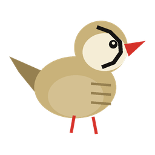
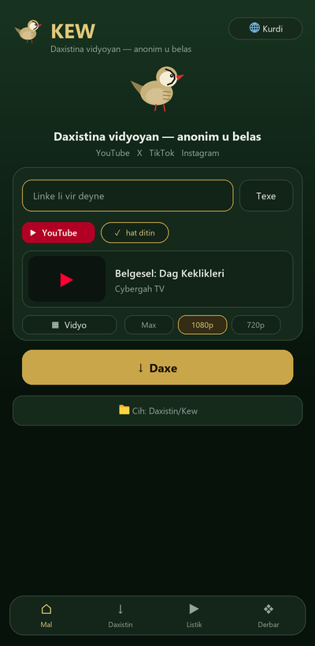
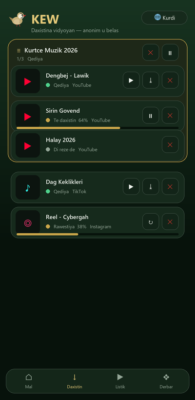
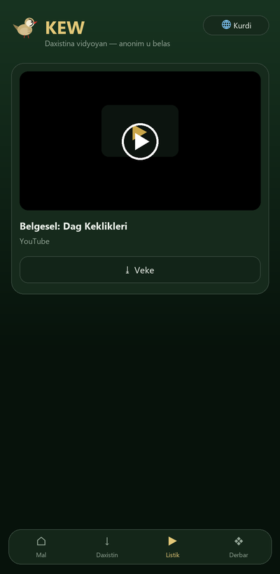
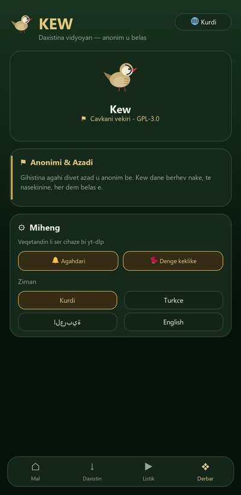

<p align="center">
  
</p>

<h1 align="center">🦃 KEW</h1>

<p align="center">
  <b>Daxistina vîdyoyan a anonîm û belaş</b><br>
  YouTube · X · TikTok · Instagram
</p>

<p align="center">
  
  
  
  
  
</p>

<p align="center">
  <i>Ji aliyê <b>Cybergah Group</b> ve · <a href="https://cybergah.com">cybergah.com</a></i>
</p>

---

## 📖 Kew çi ye?

**Kew** (bi kurmancî navê teyrê çiya — *keklîk*) sepaneke **çavkanî-vekirî**, **anonîm** û bi temamî **belaş** e ji bo daxistina vîdyoyan ji **YouTube, X (Twitter), TikTok û Instagram**ê.

> Em bawer dikin ku gihîştina agahiyê divê **azad û anonîm** be.

- ❌ Bê hesab (account)  ·  ❌ Bê şopandin (tracking)  ·  ❌ Bê reklam
- ✅ Naverok tenê li ser **cîhaza te** dimîne
- ✅ Veqetandin (extraction) **li ser cîhazê** bi `yt-dlp` tê kirin — **bê pêşkêşkar (server)**

Navê "Kew" îlham ji teyrê azad ê çiyayan digire; loma reng (kesk û zêr) û logo li gorî keklîkê ne.

---

## ✨ Taybetmendî

| | Taybetmendî |
|---|---|
| 🔗 | Lînkê têxe û daxe — 4 platform otomatîk têne nasîn |
| 🎬 | **Lîsteyên YouTube (playlist)** — her vîdyo serbixwe tê daxistin |
| ⏯️ | Lîsteya tevahî bi yek bişkokê **rawestîne / bidomîne / betal bike** |
| 🎵 | **Vîdyo** an **tenê deng (MP3)**, hilbijartina kalîteyê (Max/1080/720/480) |
| 💾 | Rasterast li peldanka **`Daxistin/Kew`** tomar dike |
| ▶️ | Lîstikvanê (player) hundirîn + vekirin bi lîstikvanê pergalê |
| 🔁 | Vîdyoya ku danabe **bixweber 3 caran** ji nû ve diceribîne |
| 🔔 | Li **paşperdeyê** daxe; dema xilas bû bi **dengê keklîkê** agahdar dike |
| 🌍 | **5 ziman** + piştgiriya rast-bi-çep (RTL) |
| 🎨 | Navrûyek React a nûjen, anîmasyonî, bi temaya keklîkê |

---

## 📱 Wêneyên ekranê

| Mal | Daxistin | Lîstik | Mîheng |
|:---:|:---:|:---:|:---:|
|  |  |  |  |

---

## 🏗️ Çawa dixebite (Avahî)

```
┌─────────────────────────────┐
│  Navrû:  React + TypeScript + Vite     │  ← UI, 5 ziman, RTL, anîmasyon
├─────────────────────────────┤
│  Pakêt:  Capacitor 6 (Android)         │  ← WebView + bridge
├─────────────────────────────┤
│  Daxistin: Plugina Java a xwemalî      │  ← yt-dlp + ffmpeg li ser cîhazê
│            (KewYtdlpPlugin)            │     getInfo / playlist / download
│            + Foreground Service        │  ← daxistina paşperdeyê + wake-lock
│            + MediaStore                │  ← tomarkirina Downloads/Kew
└─────────────────────────────┘
```

- **Veqetandin** bi `io.github.junkfood02.youtubedl-android` (yt-dlp) li ser cîhazê tê kirin; xwe ji **nightly** kanalê nû dike, loma guherînên malperan (nemaze TikTok/YouTube) zû têne sererastkirin.
- **Bê pêşkêşkar:** tu daneyê nayê şandin tu cihê derve. Tam anonîm.
- **Daxistina paşperdeyê:** `KewDownloadService` (foreground service) + `PARTIAL_WAKE_LOCK` pêvajoyê zindî digire dema sepan girtî ye.
- **Deng:** dema daxistin xilas dibe, dengê keklîkê bi `MediaPlayer` (kanala agahdariyê) tê lêdan.

### Stek a teknîkî

| Tişt | Teknolojî |
|---|---|
| Navrû | React 18, TypeScript, Vite 5 |
| Pakêt | Capacitor 6 |
| Veqetandin/Daxistin | yt-dlp (youtubedl-android) + ffmpeg |
| Hilanîn | Capacitor Preferences |
| Ziman | ku · tr · ar · en · fa (ar/fa = RTL) |
| Lîsans | GPL-3.0-or-later |

---

## 📂 Avahiya projeyê

```
kew/
├─ src/                      # Koda React (TypeScript)
│  ├─ App.tsx                # Navrûya sereke + rêza daxistinê (queue)
│  ├─ lib/
│  │  ├─ i18n.ts             # 5 ziman
│  │  ├─ native.ts           # Pira bo pluginên xwemalî
│  │  ├─ platform.ts         # Naskirina platformê ji lînkê
│  │  └─ store.ts            # Mîheng + tomara daxistinan
│  ├─ components/Intro.tsx   # Anîmasyona keklîkê ya destpêkê
│  └─ assets/Logo.tsx
├─ android/
│  └─ app/src/main/java/com/cybergah/kew/
│     ├─ KewYtdlpPlugin.java       # yt-dlp: info/playlist/download/deng
│     ├─ KewDownloadService.java   # Foreground service
│     └─ MainActivity.java
├─ tools/                    # Skrîptên Python: îkon, deng, wêne, kilavuz, vîdyo
├─ capacitor.config.ts
└─ package.json
```

---

## 🔨 Çawa tê avakirin (build)

Pêdivî: **Node.js 18+**, **JDK 17**, **Android SDK** (build-tools 34/35).

```bash
# 1) Pakêtan saz bike
npm install

# 2) Navrûyê ava bike
npm run build

# 3) Li projeya Androidê kopî bike
npx cap sync android

# 4) APK ava bike
cd android
./gradlew assembleRelease       # Windows: gradlew.bat assembleRelease
```

APK li vir derdikeve:
```
android/app/build/outputs/apk/release/app-release.apk
```

> Di vê komitê de release bi **debug-key** tê îmzekirin (bê sir). Ji bo weşanê, kilîda xwe ya release çêke (binêre `BUILDING.md`).

### Avakirina amûran (vebijarkî)
```bash
python tools/make_icon.py export android/app/src/main/res src/assets   # logo/îkon
python tools/make_sound.py android/app/src/main/res/raw/keklik.wav src/assets/keklik.wav
python tools/mockups.py all      # wêneyên ekranê
python tools/make_guide.py       # rêbera bikaranînê (HTML)
```

---

## 🔐 Îmzekirin

Kilîda release **tê de nayê parvekirin** (sir e). Kilîda xwe çêke:

```bash
keytool -genkeypair -v -keystore my-release.keystore -alias kew \
  -keyalg RSA -keysize 2048 -validity 10950
```

Paşê di `android/app/build.gradle` de `signingConfigs.release` lê zêde bike û ji
guherbarên hawirdorê (environment variables) şîfreyan bixwîne.
**Tu carî kilîd an şîfreyan nede commitkirin.**

---

## 🌍 Ziman

Navrû bi **5 zimanan** e û tavilê tê guhertin:

**Kurdî · Türkçe · العربية · English · فارسی**

Ji bo Erebî û Farisî navrû bi temamî **rast-bi-çep (RTL)** ye.

---

## ⚑ Anonimî û Azadî

> Kew tu daneyên kesane berhev nake, tu çavdêriyê nake û her dem belaş e.
> Veqetandin li ser cîhaza te dibe — tu pêşkêşkar, tu aliyê sêyemîn.
>
> **Em ji bo înternetek azad û anonîm dixebitin.**
> — *Cybergah Group*

---

## 📜 Lîsans

**GPL-3.0-or-later** — Nermalava azad. Bi kar bîne, vekole, parve bike, baştir bike.

Binêre [`LICENSE`](LICENSE).

---

<p align="center">
  <br>
  <b>Cybergah Group</b> · <a href="https://cybergah.com">cybergah.com</a> · info@cybergah.com<br>
  <sub>Kew v1.0.0 · © 2026 · Çavkanî vekirî / Open source</sub><br>
  <sub><i>Azad wek çûk. 🕊️</i></sub>
</p>
